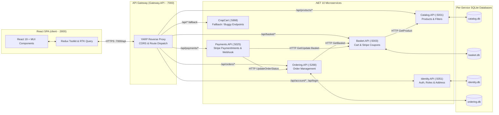

# CrapCart E-Commerce Project: Microservices & API Gateway Architecture Guide

> **Course Reference:** *Build an E-Commerce App with .NET Core and React* (Neil Cummings)  
> **Backend:** ASP.NET Core (.NET 10) Microservices, YARP Reverse Proxy Gateway & Entity Framework Core (SQLite)  
> **Frontend:** React 19, TypeScript, Redux Toolkit & RTK Query, Material UI (MUI)  
> **External Integrations:** Stripe (Payments & Coupons), Cloudinary (Image CDN)

---

## 1. High-Level Microservices Architecture



---

## 2. Root Project Structure (`E-Commerse.slnx`)

```
d:\E-Commerse\
├── Gateway.API/               # YARP API Gateway (https://localhost:7000)
├── Catalog.API/               # Product Catalog Microservice (https://localhost:5001)
├── Basket.API/                # Shopping Basket & Coupon Microservice (https://localhost:5003)
├── Identity.API/              # Authentication & User Address Microservice (http://localhost:5051)
├── Ordering.API/              # Orders Microservice (http://localhost:5268)
├── Payments.API/              # Stripe Payments & Webhook Microservice (http://localhost:5025)
├── CrapCart/                  # Original Monolith API Fallback (https://localhost:5868)
├── client/                    # Frontend React SPA (https://localhost:3000)
├── E-Commerse.slnx            # .NET 10 Solution File containing all projects
├── stripe.exe                 # Stripe CLI for local payment webhook forwarding
└── PROJECT_ARCHITECTURE_AND_FLOW.md
```

---

## 3. Microservice Responsibilities & Ports

| Service | Default URL(s) | Database | Key Endpoints |
| :--- | :--- | :--- | :--- |
| **`Gateway.API`** | `https://localhost:7000`<br>`http://localhost:5000` | *Stateless* | Proxies all `/api/*` requests from React (`https://localhost:3000`) to downstream microservices |
| **`Catalog.API`** | `https://localhost:5001`<br>`http://localhost:5002` | `catalog.db` | `GET/POST/PUT/DELETE /api/products`, `GET /api/products/filters` |
| **`Basket.API`** | `https://localhost:5003`<br>`http://localhost:5004` | `basket.db` | `GET/DELETE /api/basket/{basketId}`, `POST /api/basket/items`, `DELETE /api/basket/{basketId}/items/{productId}`, `POST /api/basket/{code}`, `DELETE /api/basket/remove-coupon`, `PUT /api/basket/{basketId}/payment-intent` |
| **`Identity.API`** | `http://localhost:5051`<br>`https://localhost:7125` | `identity.db` | `POST /api/login`, `POST /api/account/register`, `GET /api/account/user-info`, `POST /api/account/logout`, `GET/POST /api/account/address` |
| **`Ordering.API`** | `http://localhost:5268`<br>`https://localhost:7273` | `ordering.db` | `GET /api/orders`, `GET /api/orders/{id}`, `POST /api/orders`, `PUT /api/orders/{id}/status`, `PUT /api/orders/payment-intent/{paymentIntentId}/status` |
| **`Payments.API`** | `http://localhost:5025`<br>`https://localhost:7143` | *Stateless* | `POST /api/payments`, `POST /api/payments/{basketId}`, `POST /api/payments/webhook` |
| **`CrapCart`** | `https://localhost:5868` | `crapcart.db` | Fallback routes (e.g. `/api/buggy/*`) |

---

## 4. End-to-End Microservice Flows

### Flow 1: Product Browsing, Searching & Filtering (`Catalog.API`)
1. React dispatches `GET https://localhost:7000/api/products` with query parameters (`orderBy`, `searchTerm`, `brands`, `types`, `pageNumber`, `pageSize`).
2. `Gateway.API` matches `catalog-route` (`/api/products/{**catch-all}`) and forwards to `Catalog.API` (`https://localhost:5001`).
3. `Catalog.API` queries `catalog.db`, appends the `Pagination` header, and `Gateway.API` exposes `Pagination` to the browser via `WithExposedHeaders("Pagination")`.

### Flow 2: Shopping Basket & Promo Coupons (`Basket.API` ↔ `Catalog.API`)
1. React generates or reads the `basketId` cookie and calls `POST /api/basket/items`.
2. `Basket.API` calls `Catalog.API` (`GET /api/products/{id}`) via `CatalogService` to verify product stock and price.
3. Applying a promo code (`POST /api/basket/{code}`) invokes `DiscountService` in `Basket.API` to validate the Stripe promotion code and attach the `AppCoupon` to the basket.

### Flow 3: User Authentication & Saved Addresses (`Identity.API`)
1. `IdentityDbInitializer` seeds roles (`member`, `admin`) and default users (`bob@test.com` and `admin@test.com` with password `Pa$$W0rd`).
2. React sends `POST /api/login?useCookies=true` and `/api/account/*` through `Gateway.API` to `Identity.API` (`http://localhost:5051`).

### Flow 4: Stripe Checkout & Order Creation (`Payments.API` ↔ `Basket.API` ↔ `Ordering.API`)
1. Entering `/checkout` triggers `POST /api/payments` via `Gateway.API` to `Payments.API`.
2. `Payments.API` fetches the customer's basket from `Basket.API`, creates or updates a Stripe `PaymentIntent` for `subtotal - discount + deliveryFee`, and saves `PaymentIntentId` & `ClientSecret` back to `Basket.API`.
3. When the customer submits payment in `CheckoutStepper.tsx`:
   - React calls `POST /api/orders` (`Ordering.API`), which fetches the basket from `Basket.API` and saves the `Order` with `ShippingAddress`, `PaymentSummary`, `Discount`, `DeliveryFee`, and `Total`.
   - React confirms the payment with Stripe using `stripe.confirmPayment`.
   - Stripe webhook (`POST /api/payments/webhook`) notifies `Payments.API`, which calls `Ordering.API` to mark the order status as `PaymentReceived`.

---

## 5. How to Run the Complete Project

### 1. Start the Microservices & Gateway (in separate terminals)
```powershell
# 1. Catalog Service (:5001)
dotnet run --project d:\E-Commerse\Catalog.API

# 2. Basket Service (:5003)
dotnet run --project d:\E-Commerse\Basket.API

# 3. Identity Service (:5051)
dotnet run --project d:\E-Commerse\Identity.API

# 4. Ordering Service (:5268)
dotnet run --project d:\E-Commerse\Ordering.API

# 5. Payments Service (:5025)
dotnet run --project d:\E-Commerse\Payments.API

# 6. API Gateway (:7000)
dotnet run --project d:\E-Commerse\Gateway.API
```

### 2. Start the React Frontend (`:3000`)
```powershell
cd d:\E-Commerse\client
npm run dev
```

### 3. (Optional) Forward Stripe Webhooks to Gateway
```powershell
cd d:\E-Commerse
.\stripe.exe listen --forward-to https://localhost:7000/api/payments/webhook --skip-verify
```
